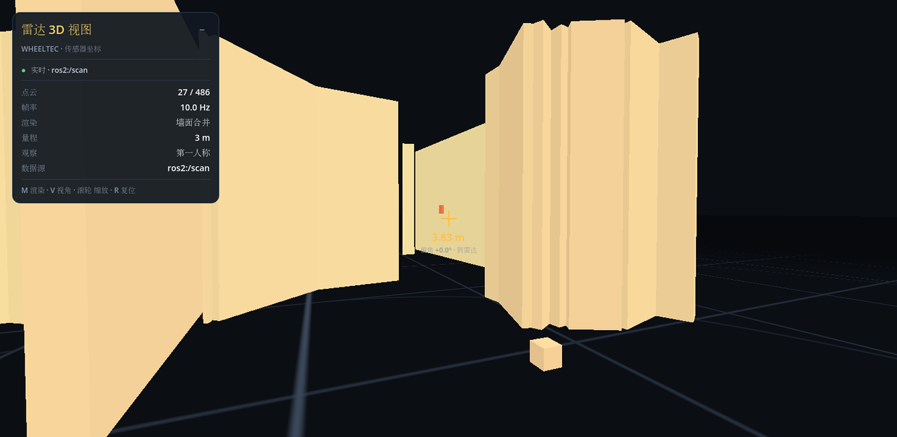

# WHEELTEC 雷达 3D 视图

把小车激光雷达的散点扫描,渲染成俯视角的 3D 方块场景:车模型居中,周围是雷达
测到的墙面/障碍物。Godot 前端 + Python 中间件,两端用 UDP 通信。



## 为什么需要中间件

Godot 不能直接连 ROS2。所以由 `bridge/lidar_bridge.py` 订阅 ROS 话题,把数据打成
紧凑的二进制 UDP 包发给同机的 Godot。这样 **Godot 侧不需要任何 ROS 依赖**,也避免了
跨机的 DDS 组播问题。

```
┌─────────────────────────────┐        ┌──────────────────────────┐
│ 小车 (Linux / ROS2 Humble)   │        │ 电脑                      │
│                             │  SSH   │                          │
│ 雷达驱动 → /scan ───────────┼───────→│ lidar_bridge.py          │
│                             │        │   │  UDP 127.0.0.1:9100   │
└─────────────────────────────┘        │   ▼                      │
                                       │ Godot: 解析 → 合并 → 渲染 │
                                       └──────────────────────────┘
```

## 运行

先让 Godot 里的 `main.tscn` 跑起来(它会在 `127.0.0.1:9100` 等数据),然后按需要
选一种数据源启动中间件。

**1. 合成数据(不用小车,调界面用)**

```sh
python3 bridge/lidar_bridge.py --source demo
```

**2. 回放录好的 bag(不用 ROS)**

```sh
python3 bridge/lidar_bridge.py --source bag \
    --bag ~/桌面/ROS/bags/wheeltec_20261013_185317 --topic /scan --loop
```

**3. 接实车**

```sh
# 在 ROS 目录先把雷达拉起来
cd ~/桌面/ROS && ./connect_wheeltec.sh start

# 再启动中间件(它会自己进 Humble 容器, 因为 rclpy 在容器里)
cd ~/ctrlscene && ./bridge/run_live.sh
```

## 操作

| 键 | 作用 |
| --- | --- |
| `M` | 切换合并方式:散点 → 网格合并 → 墙面合并 |
| `T` | 切换视角:正俯视 / 斜俯视 |
| 滚轮 | 缩放视野半径 |
| `R` | 复位(同时恢复自动适配) |

**自动适配视野**:启动后的前 5 帧会按当前扫描的最远点自动定视野
(`最远点 × 1.3`,夹在 3~30m);一旦你滚动滚轮就锁定,不再自动改。
不同房间量程差别很大(实测有 5m 的小房间,也有 10m 的办公室),固定视野会让
小房间显得空、大房间装不下。

## 三种合并方式

激光是"每度一个测距值"的散点,直接画会又碎又乱。`scripts/point_cloud.gd` 提供三种:

| 模式 | 做法 | 540 点实测输出 |
| --- | --- | --- |
| **散点** | 每个有效点一个小方块 | 484 个 |
| **网格合并** | 按 14cm 网格归类,每格只留最近的点 | 71 个 |
| **墙面合并** | 沿扫描顺序把点拟合成线段,用长条方块表示 | 23~33 个 |

**墙面合并**的做法值得说一下:

1. 先按扫描顺序切片——相邻点距离超过 40cm 就断开(遇到墙角、物体边缘自然断开);
2. 每片内做折线简化:从起点往后试,只要中间所有点到"起点→试探点"这条直线的垂距
   都 ≤ 7cm 就继续延长,单段最长 1.8m;
3. 每段画成一个长条方块,宽 9cm、高 30cm。

这样一面 8m 的墙会被 4~5 个长条拼出来,而不是几百个小方块。孤立点(比如细柱子)
单独补一个小方块,不会被漏掉。

## 第一人称与准星测距

按 `V` 切到第一人称:相机坐在车顶雷达的位置朝前看,自车模型自动隐藏(像 FPS 一样),
墙体按 1.35m 高度渲染,地板网格一直延伸到远处。

屏幕中央有准星。它会显示**当前视线方向上的雷达测距**:

```
        3.83 m
   偏角 +0.0° · 到雷达
```

- **取的是"角度上最接近视线的那条射线"**,不是"锥内最近的障碍"。
  稀疏激光一旦正前方有空洞,取最近点会跳到更远的那面墙上,出现"看着很近却报很远"
  的假读数;按射线取则和雷达自己的测量一一对应。
- 数值是**雷达原始测距**,从激光原点(≈车体中心)算,和 `ros2 topic echo /scan`
  完全一致,可以直接对账。实测同帧 `ranges[270]=0.339` ↔ HUD `0.34 m`。
- 下方的**偏角**是视线与该射线的夹角,最大不超过 `cone_degrees`(默认 2.5°)。
  偏角大就说明你正好在两条射线之间,读数是最近的那条,不是插值。
- 命中的墙面上会出现一个橙色方块标出该测距点。

> 注意:数值从**雷达**算起。车的"车头"在雷达前方约 0.29m,所以肉眼量车头到墙的距离
> 会比读数小 0.29m 左右。这是参考点不同,不是世界缩放问题 —— 世界是 1 单位 = 1 米,
> 激光点数也是米。

## HUD

左上角是一个**独立场景** `scenes/hud.tscn`,不是一个脚本画出来的:

- **拖动**:按住标题栏拖走
- **折叠**:点 `−` / `+`
- 新增一行状态只需在 tscn 的 `Stats` 网格里加两个 Label(值那个勾上
  `unique_name_in_owner`),再在 `update_state()` 里赋一次值
- 配色集中在 `hud.gd` 顶部的常量里,和点云/地面共用同一套 Kenney 调色板

## 关键实现细节

**坐标映射**。`/scan` 是雷达自身坐标系(x 朝前、y 朝左、角度 0 = +x 逆时针)。
映射到 Godot(-Z 朝前、+X 朝右)用:

```gdscript
Vector3(-r*sin(a), 0, -r*cos(a))
```

因为数据本来就是车体相对坐标,所以车模型放原点、点云绕它摆,天然就是
"车辆居中俯视",不需要里程计。

**变换顺序**。方块用 `Basis(UP, yaw) * Basis.from_scale(size)`。
不能写成 `Basis(UP, yaw).scaled(size)` —— 后者是按行缩放(S×R),旋转 90° 时
会把长度和宽度互换,竖直方向的墙段会塌成一个个小点,看起来像虚线。
这个坑踩过,注释里留了记录。

**MultiMesh**。所有方块用一个 `MultiMeshInstance3D` 一次 draw call 画完,
每帧只更新实例变换和颜色,540~2000 个实例对帧率没有影响。

**颜色**。按距离插值:近处橙红 `#ff7e44` → 中段琥珀 `#ffd565` → 远处冷蓝
`#6794d9`,都取自参考项目的 Kenney 调色板。

**在线判定**。HUD 的绿点表示最近 1.5 秒内收到过新扫描;断流时变红并显示已中断
多少秒,不会把旧帧当实时画面。

## 素材来源

车辆和地面模型来自 `~/桌面/godot/proj/sokoban`(ShenMian/Sokoban),素材是
Kenney 的 [Prototype Kit](https://kenney.nl/assets/prototype-kit)(CC0):

- `assets/models/car/van.glb` — 车体(来自 Kenney **Car Kit**,同样 CC0)
- `assets/models/car/Textures/colormap.png` — 该 kit 的调色板贴图
- 雷达柱、地面光环用 Godot 原生圆柱/圆环 + 同一套平涂着色器

`colormap.png` 必须放在 glb 同级目录的 `Textures/` 下(路径大小写敏感,glb 里写死了),
否则模型会渲染成纯白。参考项目里的 `.glb`/`.png` 原本是 Git LFS 指针,真文件需要单独拉取。

## 文件

| 文件 | 职责 |
| --- | --- |
| `main.tscn` | 场景:环境、灯光、相机、地面、车、点云、HUD |
| `scenes/hud.tscn` | HUD 组件:可拖动/可折叠的调试窗口 + 准星 |
| `scripts/lidar_viewer.gd` | 主控:收包分发、三种视角、准星测距、HUD 刷新 |
| `scripts/lidar_receiver.gd` | UDP 收包与协议解析 |
| `scripts/point_cloud.gd` | 三种合并算法 + MultiMesh 渲染 |
| `scripts/hud.gd` | 代码构建的状态面板 |
| `shaders/box.gdshader` | 方块:平涂 + 法线明暗 |
| `shaders/grid.gdshader` | 地面:米制网格 + 2m 测距环 + 淡出 |
| `bridge/lidar_bridge.py` | 中间件:ros2 / bag / demo 三种数据源 |
| `bridge/run_live.sh` | 在容器里接实车 |
| `bridge/PROTOCOL.md` | UDP 协议定义 |

## 扩展

中间件分数据源和出口两层,加新内容只动一边:

- **加相机**: 在 `lidar_bridge.py` 里加一个 `IMAGE` 编码函数(协议里已预留
  `MSG_IMAGE`),Godot 侧在 `_decode` 里加一个分支。
- **加里程计/电池**: 复用 `MSG_STATUS` 的 JSON 负载,把字段塞进 dict 即可,
  Godot 的 `status_received` 信号已经接好。

## 踩过的坑

**`Basis.scaled()` 是 S×R,不是 R×S。** 方块变换必须写成
`Basis(UP, yaw) * Basis.from_scale(size)`。写成
`Basis(UP, yaw).scaled(size)` 时,旋转 90° 会把长度和宽度互换,竖直方向的墙段
全塌成 9cm 的小点,看起来像虚线。用 `game_eval` 打印实例的 `basis.x.length()`
才定位到(486 点里 19 个实例,其中竖直墙的 `L=0.09` 而不是 `L=1.79`)。

**中间件只能有一份。** 两份 bridge 同时往 `127.0.0.1:9100` 发,数据会交错,
序号乱跳、画面抖动。检查:`pgrep -af "lidar_bridge"` 应该只有一个 python 进程
(加上一层 `docker run` 壳共 2 行)。另外 `job_kill` 只是杀外层壳,容器内的进程
可能还在,必要时 `docker ps -q --filter ancestor=wheeltec-humble:latest | xargs -r docker kill`。

**场景里必须有灯。** 车模用的是需要光照的 `StandardMaterial3D`,而点云和地面用的是
`unshaded` 自定义着色器 —— 所以整场没灯时,点云/地面一切正常,车模却是纯黑的一团。
加了一盏 `DirectionalLight3D` + 环境光才正常。

**车模的原点不在底面。** Kenney 的车模 y 范围是 -1..1.15,缩放 0.21 后车顶在
`0.21 + 1.15*0.21 = 0.4515`,不是想当然的 `1.15*0.21`。一开始雷达柱和第一人称
相机都按错误高度摆,结果全埋进车身里。

**ROS 源的 `seq` 必须是自增计数器。** 一开始我拿
`stamp.nanosec ^ stamp.sec` 当序号,它不是单调递增的,接收端按"序号断档"算丢包,
计数会瞬间涨到 500 亿。已改成自增,并在接收端给丢包计数加了 1000 的上限。

## 限制

- 只渲染雷达原始观测,**不做 SLAM、不做定位、不叠加地图**。
- 相机和雷达没有时间同步和外参标定,不能据此认为某个像素对应某个激光点。
- 视野是雷达自身坐标系;想显示"车在世界里的轨迹"需要再接 `/odom`,目前没做。
- 中间件按 bag 原始时间戳节奏回放,不保证严格实时。
